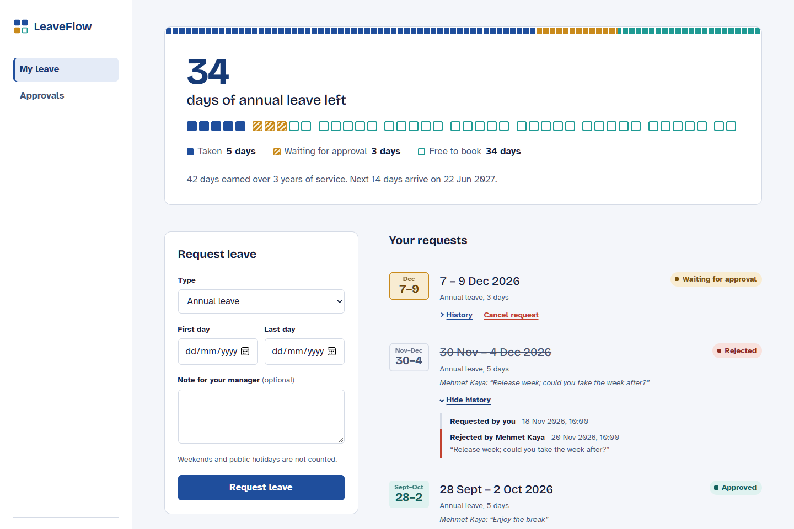
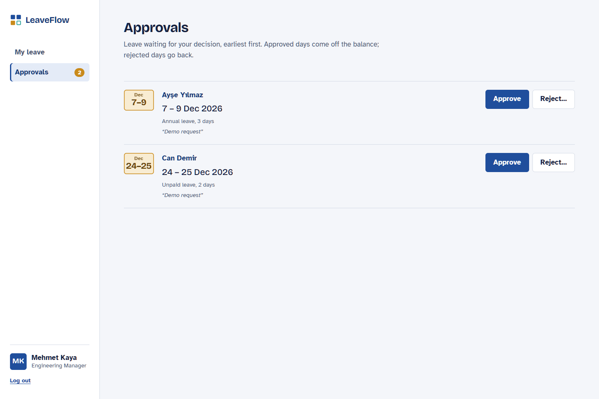
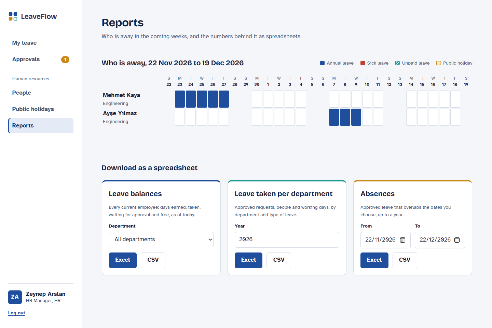
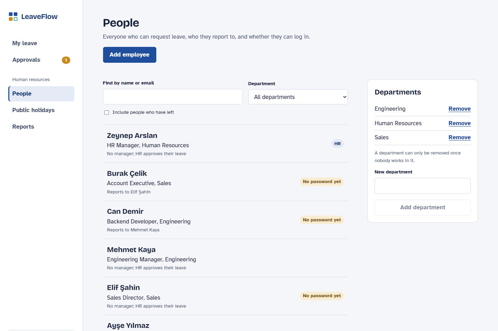
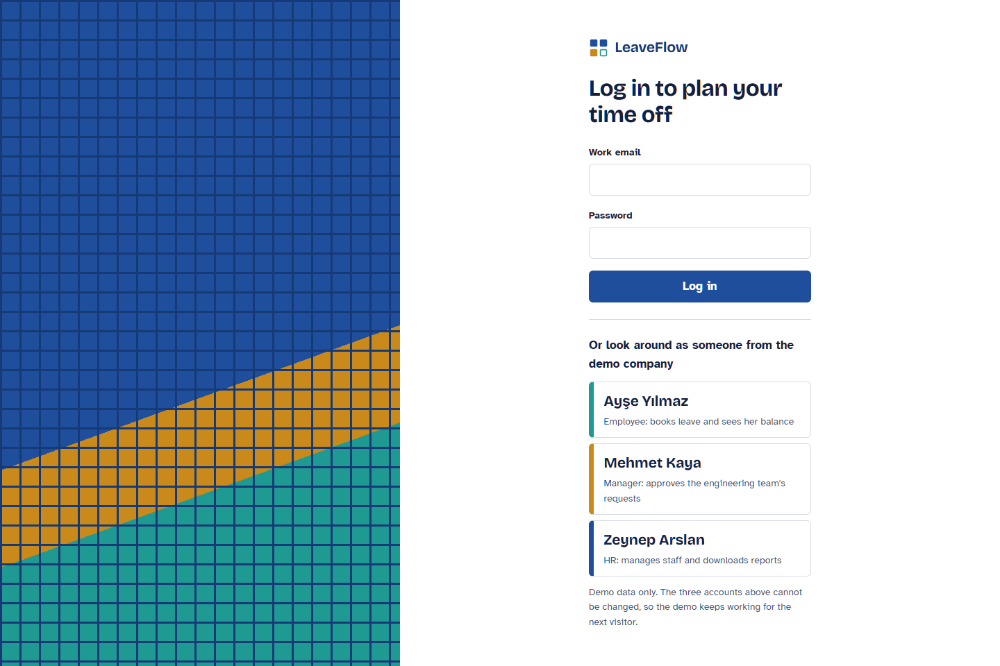

# LeaveFlow


A leave management app for small companies, built with Spring Boot and React. Employees request leave, managers approve or reject it, and HR manages people and holidays. Annual leave is calculated according to the Turkish Labour Law (No. 4857, Art. 53).

**Live demo:** https://leaveflow-demo-qwj5.onrender.com. Log in as Ayşe (employee), Mehmet (manager) or Zeynep (HR) from the login page. It runs on a free plan, so the first visit can take up to a minute.



| Approvals | Reports |
|---|---|
|  |  |
| **People** | **Login** |
|  |  |

## Features

- Annual leave balance calculated from hire date and age (14 / 20 / 26 days)
- Leave requests with approve / reject / cancel, only by the employee's own manager
- Weekends and public holidays are not counted as leave days
- JWT login with two roles: `EMPLOYEE` and `HR` (a manager is anyone with direct reports)
- History of every leave request (who did what and when)
- HR reports as JSON, Excel or CSV
- React frontend for employees, managers and HR

## Tech stack

- **Backend:** Java 21, Spring Boot 4, Spring Data JPA, Spring Security (JWT), PostgreSQL, Flyway
- **Frontend:** React, TypeScript, Vite, TanStack Query
- **Testing:** JUnit 5, Testcontainers, MockMvc, JaCoCo
- **Other:** Docker, GitHub Actions, Swagger (springdoc), Apache POI

## Running locally

The easiest way is the demo setup. You only need Docker:

```bash
docker compose -f compose.demo.yaml up --build
```

Then open http://localhost:8080 and choose one of the demo accounts. Swagger UI is at http://localhost:8080/swagger-ui.html.

For development (JDK 21 and Docker needed):

```bash
./mvnw spring-boot:run          # backend on :8080, starts PostgreSQL from compose.yaml
cd frontend && npm install && npm run dev   # frontend on :5173
```

On the first start an HR account `hr@leaveflow.local` is created. Its password is printed in the log, or you can set it with `LEAVEFLOW_ADMIN_PASSWORD`. Other settings:

| Variable | Description |
|---|---|
| `LEAVEFLOW_JWT_SECRET` | Key for signing tokens (min. 32 characters). Random if empty. |
| `LEAVEFLOW_ADMIN_EMAIL` / `LEAVEFLOW_ADMIN_PASSWORD` | First HR account |

## Tests

```bash
./mvnw verify
```

Integration tests use a real PostgreSQL in Docker (Testcontainers). There are around 140 tests and the build fails if line coverage is under 90%.

## Leave rules

| Years of service | Days per year |
|---|---|
| 1 – 5 | 14 |
| 6 – 14 | 20 |
| 15+ | 26 |

- Nothing is earned in the first year.
- Employees aged 18 or younger, or 50 and older, get at least 20 days.
- Available days = earned − approved − pending.
- Two requests of the same person cannot overlap.
- Annual and unpaid leave cannot start in the past. Sick leave can.
- A rejection needs a note.

## API

All endpoints are documented in Swagger UI. Some examples:

| Endpoint | Description |
|---|---|
| `POST /api/auth/login` | Login, returns a JWT |
| `GET /api/employees/{id}/leave-balance` | Leave balance of an employee |
| `POST /api/leave-requests` | Request leave for yourself |
| `POST /api/leave-requests/{id}/approve` | Approve (direct manager) |
| `GET /api/leave-requests/{id}/history` | History of a request |
| `GET /api/reports/leave-balances?format=xlsx` | Balance report as Excel (HR) |

Errors are returned as `application/problem+json`.

## Some notes

Things I paid attention to while building this:

- The leave balance is not stored in the database. It is calculated every time, so it can't get out of sync.
- When two requests come at the same time, the employee row is locked so the same days can't be used twice. Managers deciding at the same time are handled with optimistic locking (`@Version`).
- Status changes are only possible through methods on the `LeaveRequest` entity. These methods also publish events, which are saved as the request's history.
- The schema is managed by Flyway; Hibernate only validates it.
- Tests run against a real PostgreSQL instead of H2.
- A fixed `Clock` is used in tests so date-based rules give the same result every day.

The database schema is in [docs/data-model.md](docs/data-model.md).

## Deployment

The live demo runs on Render (Docker) with a free Neon PostgreSQL database. The setup is in [`render.yaml`](render.yaml). Database credentials are entered in the Render dashboard, not in the repo.

## What could be added

- Refresh tokens (now a token is valid for 1 hour even if the user is deactivated)
- Email notifications to managers
- Half-day leave
