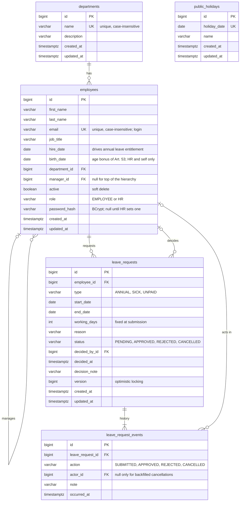

# Data model

The tables are created by the Flyway migrations in `src/main/resources/db/migration`.

## Notes

- There is no balance table. The balance is calculated from the hire date, birth date and leave requests.
- The number of working days is saved when a request is created, so adding a holiday later doesn't change old requests.
- `leave_request_events` only gets new rows, nothing is updated or deleted.
- Some rules are also checked in the database (dates, allowed status values, an employee can't be their own manager).
