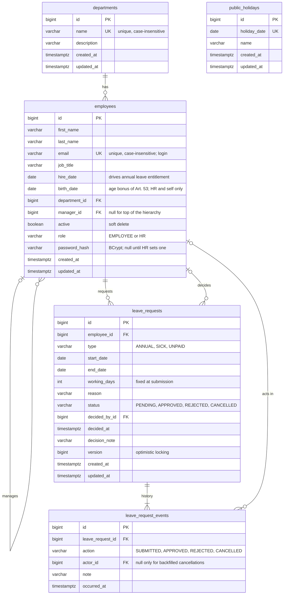

# Data model

The schema is created by the Flyway migrations in `src/main/resources/db/migration` (V1 to V5).
Hibernate only validates it. GitHub renders the diagram below.

## Notes

- **No balance table.** The annual leave balance is computed from `hire_date`, `birth_date` and the approved and pending `ANNUAL` requests, so it cannot get out of sync.
- **`public_holidays` stands alone.** It is read when a request is submitted: weekends and these dates are not working days. The result is stored in `leave_requests.working_days`, so adding a holiday later does not rewrite past requests.
- **`leave_request_events` is append-only.** The application inserts a row on every status change and never updates or deletes one.
- **Checks in the database as well as in code:**
  - `end_date >= start_date`
  - `working_days > 0`
  - `hire_date > birth_date`
  - an employee is not their own manager
  - the allowed values of `type`, `status`, `role` and `action`

  These still hold when someone edits data with SQL.
- **Indexes:**
  - `(employee_id, start_date, end_date)` on `leave_requests` serves the overlap check.
  - `(leave_request_id, occurred_at)` on `leave_request_events` serves the history endpoint.
  - The foreign keys used for filtering (`department_id`, `manager_id`) are indexed.
